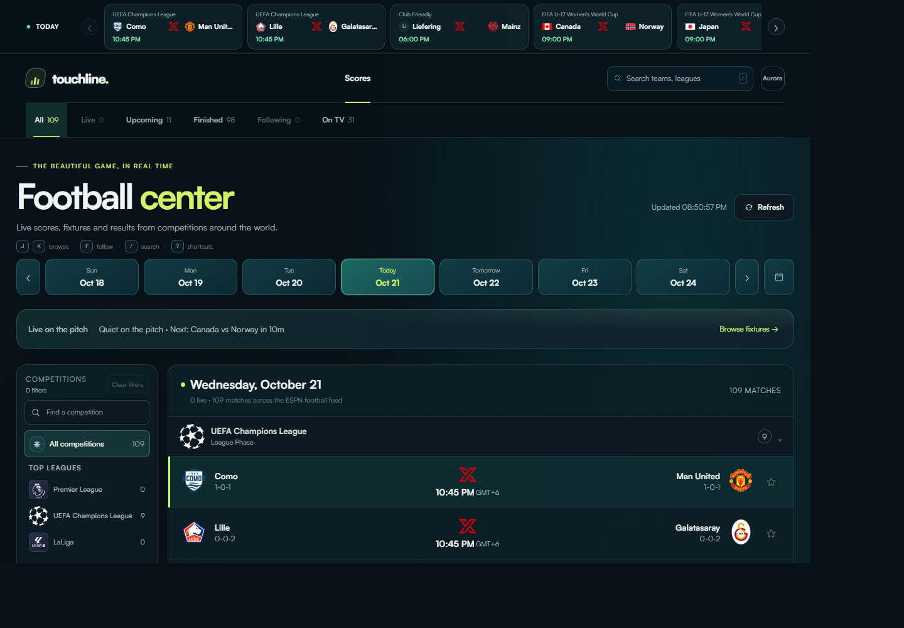
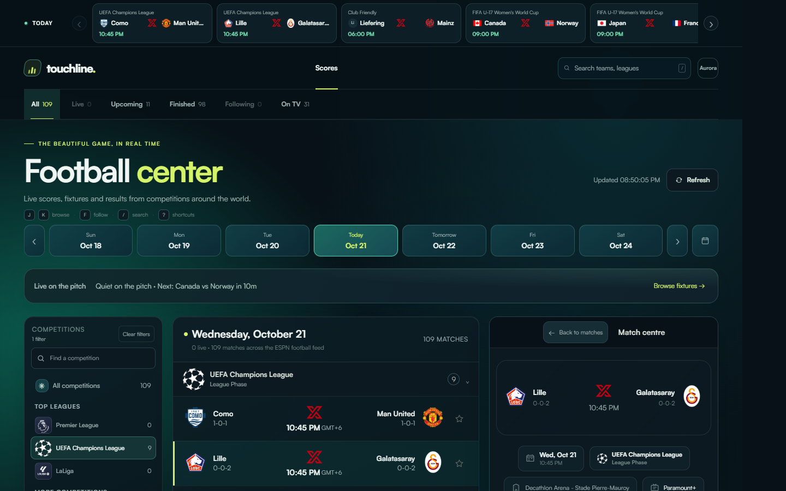

# Touchline

Touchline is a browser-based football scoreboard for daily fixtures, live scores, results, and match details. It is a static site (plain HTML, CSS, and JavaScript) with no build step, no dependencies, and no API keys.

| Scores dashboard | Match centre |
| --- | --- |
|  |  |

## Contents

- [Features](#features)
- [Run locally](#run-locally)
- [Match data](#match-data)
- [URL parameters](#url-parameters)
- [Keyboard shortcuts](#keyboard-shortcuts)
- [Saved preferences](#saved-preferences)
- [Project structure](#project-structure)
- [Limitations](#limitations)

## Features

### Scores

- Browse fixtures by date with the date strip or the calendar picker.
- Search teams and leagues, and filter by match status (All, Live, Upcoming, Finished, Following, On TV) or by competition.
- Find competitions quickly in the sidebar, which also lists pinned leagues.
- Follow matches. Followed fixtures are pinned above the main list and persist in the browser.
- Find fixtures with broadcast information listed in the feed. Availability is region-dependent.
- Follow every live match in the horizontally scrollable score strip in the header. It stays current when you browse another date, and each entry opens that match's centre.
- Score changes are announced accessibly and briefly highlighted. If a refresh fails, the last available scores stay visible with a stale-data notice.

### Match centre

Selecting a fixture opens a detail panel with these tabs:

- **Overview**: kickoff, competition, venue and broadcast details, the scoreboard, reported goal scorers, all/key-event commentary filters, and an ESPN-coordinate shot map when event locations are available.
- **Stats**: match statistics.
- **Line-ups**: formation-pitch line-ups and substitutes. Rating badges appear only when the ESPN match feed supplies explicit ratings. Otherwise the line-up says ratings are unavailable instead of estimating them.
- **Table**: standings.
- **H2H**: head-to-head information.

Match momentum is shown only when a source provides time-series pressure data. The current ESPN feed supplies key-event timestamps instead, so those are displayed and no momentum curve is invented.

On larger screens a relevant match opens automatically and the detail panel stays sticky beside the fixture list. On phones, match details open as a full-screen view.

### Appearance and accessibility

- Choose between the **Aurora**, **Neon**, and **Daylight** colour themes. Your choice is saved in the browser.
- The layout is responsive, with a clear score hierarchy, competition filters, live highlights, and match-centre layouts.
- Interactive actions give live confirmation, and score updates are announced to screen readers.

## Run locally

Serve this folder over HTTP so the browser can request the score feed:

```powershell
python -m http.server 8000
```

Then open `http://localhost:8000`.

Any other static file server works too. An internet connection is required for scores, match details, and the web fonts.

## Match data

The page reads football fixtures from ESPN's public soccer scoreboard endpoint and requests an ESPN match summary when a fixture is selected.

- Daily score requests load the neighbouring UTC dates with an expanded event limit, then group events by the browser's local date. This keeps late-night matches on the correct selected day and avoids the endpoint's default 100-event cutoff.
- Scores refresh every 15 seconds while matches are live and once per minute otherwise. Polling pauses while the browser tab is hidden.
- You can also refresh on demand.
- There are no simulated score changes. If the feed is unavailable, an error is shown instead of sample scores.

Match events, statistics, line-ups, standings, venue and broadcast information are shown when ESPN supplies them.

## URL parameters

The current view is kept in the URL, so you can share it, and browser back/forward restores the previous view.

| Parameter | Values | Description |
| --- | --- | --- |
| `date` | `YYYY-MM-DD` | Selected date. Defaults to today. |
| `status` | `live`, `pre`, `post`, `favorites`, `broadcast` | Status filter. Omitted or `all` shows every match. |
| `comp` | competition id | Competition filter. Omitted shows all competitions. |
| `match` | ESPN event id | Selected match. |

Example: `http://localhost:8000/?date=2026-10-21&status=live`

## Keyboard shortcuts

| Key | Action |
| --- | --- |
| `/` | Focus the search box |
| `J` / `K` | Move to the next / previous match |
| `F` | Follow the selected match |
| `?` | Show the shortcut hint |
| `Esc` | Clear search, or close the open match, calendar, or theme menu |

## Saved preferences

Preferences are stored in the browser's `localStorage`. If storage is unavailable, the site still works but nothing persists.

| Key | Contents |
| --- | --- |
| `touchline-theme` | Selected colour theme |
| `touchline-favorites` | Followed match ids |

## Project structure

```text
.
├── index.html     Page markup
├── styles.css     Styles and the three colour themes
├── app.js         Data fetching, rendering, filters, routing, and interactions
├── assets/        Competition logos, the Touchline mark, and README screenshots
└── README.md
```

Fonts (Satoshi and Clash Grotesk) are loaded from [Fontshare](https://www.fontshare.com/). The site falls back to Segoe UI if they cannot be loaded.

## Limitations

- The feed covers many competitions around the world, but it does not guarantee every match or every competition.
- Data availability varies by competition and by match.
- Touchline is an independent project. Scores and match data are provided by ESPN.
